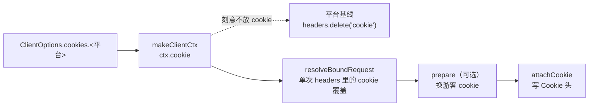

# 传输与签名

**全仓只有 `transport/` 能发请求。** 这是一条架构约束，不是习惯 —— 端点需要发请求（换游客 cookie、取 wbi key）只能通过 `ctx.send`，由 transport 注入。v6 里签名模块绕过统一入口直连 axios 的问题，在 v7 的结构下不再可能发生。

## HttpClient.send 做的事

一次 `send` 的内部顺序：

1. **构造 axios 配置** —— header 合并顺序是 **平台基线 → 实例 `requestConfig.headers` → 单次 `perCall.headers` → `spec.headers`**，每次都从输入重建 `AmagiHeaders`（大小写不敏感）。合并完再按 `spec.dropHeaders` 删头（见下）。UA 原样发出、不改写：a_bogus 的 UA 摘要、`sec-ch-ua` 品牌、抖音 `browser_name` 与小红书 webprofile 指纹都按同一个 UA 计算（2026-10-07 前这里会剥掉 `Edg/x.y`，签名用的却是原 UA）。
2. **登记 trace 并计数** —— `tracer.begin(...)`，`meta.attempts` 恒等于登记条数。这一步与 `debug` 无关。
3. **发 `http:request` 事件**（装了总线时）。
4. **`axios(config)`**。
5. **成功** → 发 `http:response`，非 2xx 再补一条 `http:error`，返回 `RawResponse`。

`RawResponse` 带 `status` / `statusText` / `headers`（`AmagiHeaders`）/ `setCookie`（**原始数组**）/ `body` / `durationMs` / `url`。

<Callout type="info">
  **刻意不设 `validateStatus`。** 于是非 2xx 走 axios 的失败分支，由 transport 自己决定是不是重试。
  这与 v6 的 `transport/legacy.ts` 相反 —— 那里是 `validateStatus: () => true`，什么状态码都算成功。
</Callout>

## `client.<平台>.request`：第二个入口，同一条管线

`client.<平台>.request`（[自定义请求](/docs/v7/usage/advanced/custom-request)）是 fetcher 之外的第二个发请求入口，但它**不新开执行路径**：axios 归一化后的配置被翻成 `RequestSpec`，现场合成一个一次性的 `EndpointDef`（`client/request/adapter.ts` 的 `makeRequestDef`），再交给同一个 `callEndpoint`。于是下面这些一样都不用重写：

| 管线提供的东西 | 在 request 这条路上的形态 |
| -------------- | -------------------------- |
| judge | 平台默认判定表（合成声明不带端点级 judge） |
| 信封 | 同一套 `AmagiResult`，成功 / 失败两支的字段一致 |
| 退避重试 | 平台档案的 `retryOn`；抖音另开 `retryFresh`，重试时重新签名生成新的 `msToken` + `a_bogus` |
| observe | 抖音回收 `webid` 的钩子照跑 —— adapter 只包一层，不替换 |
| ensureCookie | 抖音的 cookie 审计照跑 —— 缺访客 id 时先铸造再发主请求 |
| 事件 / trace | 与端点同一条线（`http:*` / `network:*` / `api:*`） |

代价是它继承了「端点」这个形状：`params` 是空对象（没有参数校验）、没有 `decode` / `normalize` / `paginate`。

两处「axios 语义 → amagi 语义」的转换都在 adapter 里：

- **`toRequestConfig`** 把配置翻给 transport，其中十三个键**不往下传**（`NOT_FORWARDED_KEYS`）：`url` / `method` / `data` 已经进了 `RequestSpec`；`params` / `paramsSerializer` / `baseURL` 已经被 `instance.getUri(config)` 拼进 URL，再传一遍会被内层 axios 拼第二次（`?a=1?a=1`、`baseURL` 双前缀）；`headers` 改从 `requestConfig.headers` 走（签名读的就是它 —— 抖音的 `a_bogus` 用 `ctx.userAgent`）；`adapter` 传下去会在**内层**覆盖掉签名与信封；`transformRequest` / `transformResponse` 漏下去会让 body 永远不序列化；`validateStatus` 下去会与 judge 打架；`responseType` 进 `spec.responseType`，`amagi` 是给 adapter 自己看的。
- **`toAxiosResponse`** 把信封包成 `AxiosResponse`。这个 adapter **恒 resolve** —— axios 的 `settle` 只在内置 adapter 里，自定义函数 adapter 的返回值不经状态校验。所以「失败抛不抛」是 `client/request/index.ts` 按**信封**决定的，与 HTTP 状态码无关；没拿到响应时 `status` 是哨兵 `0`，`AxiosError.response` 留空而不是编一个假的。

自己直接调 `HttpClient.send` 会把上面这一整列**全部**丢掉，且与端点行为分叉 —— 这就是 adapter 存在的理由。

## 抖音的 cookie 审计：缺访客 id 时自动铸造

受 secsdk 保护的端点（`/aweme/v1/web/music/detail/` 等 14 条 GET）要求 cookie 里带访客 id（`UIFID` 家族），而它**不由登录颁发**——passport 扫码链路只发身份 cookie。缺了它，这些端点稳定回 `403 Blocked by ArgusSecurityPlugin Uifid Not Found`（判 `SIGNATURE_REFUSED`）。

`PLATFORM_RUNTIME.douyin.ensureCookie` 让这件事自愈：每次调用在 prepare 之后、build/sign 之前审计一次 cookie，缺访客 id 就**纯 HTTP 铸造**一个并合并。铸造链路（线上实测）：

1. `GET www.douyin.com`（无 cookie）→ 服务端在 Set-Cookie 里发 `__ac_nonce`。响应体是一份 VMP 挑战页，**不读**；
2. 用 `sign/acSignature.ts` 的 `computeAcSignature` **纯算**出 `__ac_signature`（47 字符，`_02B4Z6wo00f01` 开头）—— 四则运算加字符串拼接，不执行挑战页里的任何脚本；
3. 带 `__ac_nonce + __ac_signature` 再 GET 一次 → 服务端一次性 Set-Cookie：`ttwid` + `enter_pc_once` + `web_sign_token` + `UIFID_TEMP`。`UIFID_TEMP` 的有效期没测过；同一 IP + UA 重复铸造每次拿到的值都不同（2026-10-11 实测）。

三个设计要点：

- **挑战页不解析、不执行**——签名算法已从 JSVMP 字节码里 lift 出来写成纯函数，`MintDeps.getHome` 的返回类型只有 `{ setCookies }`，于是「解析挑战页」在类型上就做不到。代价是抖音换算法不再自动跟随：换版的表现是服务端不认签名、第二发拿不到 `ttwid` / `UIFID_TEMP`，按铸造失败走 ttwid 回落，**没有 vm 回落**。
- **审计永不为调用增加失败**——网络失败、形状变化、签名被拒，一律原样返回，请求按既有路径走（该 `SIGNATURE_REFUSED` 还是它）；实现里不抛错，execute 也不包一层。
- **只补缺失的名字**——已有 `ttwid` 的登录态只追加 `UIFID_TEMP`，不动调用方的设备标识；进程级缓存（key = cookie + UA）让同一 cookie 只铸一次，不设过期，只有铸造成功的结果进缓存（ttwid 回落刻意不进）。

登录完成时（`session/qrcode.ts`）也审计一遍，扫码登录直接产出带访客 id 的凭证。零配置（cookie 都没配）时审计会铸造完整访客 cookie——全新部署的第一次请求就是可用的。测试环境（vitest）默认出口**不出网**，要测铸造就注入 `MintDeps.getHome`（`mint.test.ts` 全部走注入，喂的是 Set-Cookie 行数组——签名纯算之后铸造链路不碰响应体，用不上挑战页 fixture；纯算实现本身由 `ac-signature.test.ts` 拿真实挑战页做 oracle 比对）。 铸造是 amagi 自主发起的出网请求，**有权拒绝**：设 `AMAGI_DISABLE_DOUYIN_MINT=1` 关闭（cookie 保持原样，受保护端点按 `SIGNATURE_REFUSED` 归因失败）。

## `spec.dropHeaders`：端点也能删基线头

`spec.headers` 只能**覆盖**同名头，给不出「这个端点不该发某个基线头」。快手 H5 端点撞上了这个缺口：平台基线是照桌面 Chrome 攒的（`origin` / `sec-ch-ua*` / `sec-fetch-*`），而 H5 端点用移动 UA —— 拼在一起发出去的请求自我矛盾（UA 说 iPhone Safari，客户端提示说 Chrome 142 / Windows，而 Safari 根本不发 `sec-ch-ua`）。

`dropHeaders` 在所有 merge 之后执行，所以**同时出现在 `headers` 与 `dropHeaders` 里的头会被删掉** —— 端点自己要发的头别写进清单。快手那份清单是 `platforms/kuaishou/config.ts` 的 `KUAISHOU_H5_DROP_HEADERS`。

<Callout type="warn">
  如实记账：这条能力不是为了修某个风控。`photo/info` 的 `2001` 在剥到只剩 6 个头之后仍然复现 —— 改它的理由只是「发出去的请求不该自我矛盾」。
</Callout>

## 失败分支的三条路

拿到 `AxiosError` 后先问 `decideRetry`：

| 判定 | 有响应？ | 行为 |
| ---- | -------- | ---- |
| 不重试 | 有 | 走正常返回路径，状态码原样带出（交给 judge 去判） |
| 不重试 | 无 | 发 `http:response` + `network:error`，**抛 `TransportError`** |
| 重试 | — | 发 `http:response`（+ 非 2xx 时 `http:error`）+ `network:retry`，`await sleep(delayMs)` 后继续 |

非 `AxiosError` 的抛出物原样上抛，由 `execute` 的唯一 catch 归到 `internal`。

## 重试策略

策略是纯函数模块，可以单独读、单独测：

| 常量 / 函数 | 值 / 行为 |
| ----------- | --------- |
| 可恢复 errno 白名单 | 9 个（`ECONNRESET` / `ETIMEDOUT` / `ENOTFOUND` 等） |
| `DEFAULT_MAX_RETRIES` | 3 |
| `RETRY_DELAY_BASE_MS` | 1000 |
| `backoffDelayMs(attempt)` | `base × 2^(attempt-1)` → 1s / 2s / 4s |
| `isRetryableStatus` | **429 与 ≥500** |
| `retryReasonCode` | `ETIMEDOUT` → `TIMEOUT`；其他可恢复 errno → `NETWORK_ERROR`；429 → `RATE_LIMITED`；5xx → `PLATFORM_UNAVAILABLE` |

超时没有 transport 自己的实现，靠 axios 的 `timeout`。四个平台的 `config.ts` 给的默认值是 10000ms，调用方的 `request.timeout` 可以覆盖。超时归因看 errno：`ETIMEDOUT` / `ECONNABORTED` → `kind: 'timeout'` / `code: 'TIMEOUT'`。

代理、adapter 与其余 axios 字段原样透传 —— `RequestConfig` 就是 `Omit<AxiosRequestConfig, 'url' | 'method' | 'data'>`，非 headers 字段在构造配置时展开（实例级在前，单次调用在后）。

## 四个平台的签名机制

签名器表与默认 judge 在 `client/runtime.ts` 的 `PLATFORM_RUNTIME` 里一次性装配，四个入口共用同一张表。这张表也是签名器名的事实源：每个平台用 `keyof` 从它推出名字联合（如抖音 `'a-bogus' | 'x-bogus'`），`defineXxxEndpoint` 拿来把端点 `sign` 的字符串分支收窄，写错名字编译期即报错 —— 与下面各签名器运行时查表（查不到抛 `未注册的签名器`）是同一份名字的两端。

### 抖音

两个签名器，都先做前置校验再签，且**都以一步 secsdk 收尾**：

- **`a-bogus`**（19 个端点用：17 条声明 `douyinBogus(n)`，外加 `loginQrcode` 的 `[aBogus(), secsdk()]` 与 `mixAweme` 的 `sign: 'a-bogus'`）—— 先校验是绝对 URL，再用 `douyinSign.AB(...)` 签「tail 重排后、a_bogus 之前」的那段 query，结果写进 query 的 `a_bogus`。
- **`x-bogus`**（1 个端点用，`commentReplies`）—— 先校验 pathname 至少 3 段且带 query，再写 query 的 `X-Bogus`。
- **`x-secsdk-web-signature`** —— 不是第三个签名器名，而是复合进上面两个的收尾一步。它与 AB / XB 有三点不同：**改写整条 URL**（签名算的是规范化后的 query，服务端也按收到的 query 校验，所以必须发它返回的那条 URL）、**只对 SDK 策略表里的 path 生效**（14 个 GET / 6 个 POST，表外原样返回）、**必须最后执行**（顺序是 a_bogus / x_bogus → 本签名，前者往 query 里加参数）。`uifid` 从 `ctx.cookie` 的 `UIFID` 取。

<Callout>
  **为什么不注册成第三个签名器名**：`sign` 是单槽位，而 secsdk 对策略表外是无操作 ——
  无条件套用是安全的。另起一个名字只会逼出 `'a-bogus+secsdk'` 这种复合命名。
  影响面上，`music/detail`（`musicInfo`）在策略表内，补上它之前实测 15/15 被
  `Blocked by ArgusSecurityPlugin Uifid Not Found` 拦死；作品详情、用户作品、
  喜欢列表也都在表内。`sign: false` 的端点不经过签名器，它们的 path 也都不在表里。
</Callout>

**签名读的 UA 是 `ctx.userAgent`**，它来自平台基线，且能被调用方的 `headers['user-agent']` 覆盖。这条链断掉的后果很难查：用空 UA 签名，服务端必然拒绝。

另有一个 Referer 注入 helper（`douyin/referer.ts` 的 `withDouyinReferer`），7 个端点的 `build` 调它；调用方已经传了 `referer`（大小写不敏感）时不注入。

### B站

`wbi` 与 `qtparam` 两个签名器共享一个 `WbiSigner`：

- **`wbi`** —— 需要先取 nav 接口拿 key。取 nav 走的是 **`ctx.send(..., 'prepare')`**（不是直连 axios），带 30 分钟 TTL 缓存。签名用 `mixinKeyEncTab` 重排 + md5，产出 `&wts=..&w_rid=..`。
- **`qtparam`** —— cookie 为空时只加 `&platform=html5`；否则复用同一个 nav 结果读 `vipStatus`，VIP 加 `&fnval=4048&fourk=1`，非 VIP 加 `&qn=64&fnval=16`。签名基于**未加 fnval 的原始 URL**。

<Callout type="warn">
  **wbi key 缓存是进程级共享的，不是每实例一份。** `PLATFORM_RUNTIME` 是模块级 `const`，
  `createBilibiliSigners()` 在模块求值时只调用一次，所有 client 实例、静态 fetcher、HTTP 路由
  拿到的是同一个 `WbiSigner`；`sign/steps.ts` 的模块级 `sharedWbi` 也是它，所以端点声明的
  `wbi()` 与 request 层的 `sign: 'wbi'` 共用同一份 key 缓存。这也意味着：两个用不同 cookie 的
  实例会共用同一份 wbi key。
</Callout>

### 小红书

三个签名器（`xhs-post` / `xhs-get` / `xhs-get-trace`）统一注入 `x-s` / `x-s-common` / `x-t`，带 trace 的那个再加 `x-b3-traceid`。签名路径取 `spec.signPath`，缺省取 URL 的 pathname。

`a1` 从 cookie 里**按名精确匹配**取（不是子串匹配 —— 子串匹配曾经是一个真实缺陷）。算法委托同仓内联实现（`sign/xhshow/`）的模块级单例。

`prepare` 用得最多的地方也在这里：小红书**全部 13 个端点**都在 cookie 缺 `a1` 时先打三个请求换游客会话（cookie + SSK）—— 降级由 `defineXiaohongshuEndpoint` 横切注入，端点声明里不逐个写。快手两条 H5 端点也用 `prepare`（did 是纯本地生成的、不出网），另有一条 PC 端点用 `kuaishouPcPrepare`。

### 快手

一个签名器（`hxfalcon`），`live_api`（`/rest/k/*`）与 H5（`/rest/wd/*`）共用 —— 快手两套命名空间的签名算法是同一套，区别只在喂什么料。

签名的三份料全部从 spec 上取：

| 料 | 来源 | 说明 |
| -- | ---- | ---- |
| query | `spec.url` 解析 | 必须含 `caver`（它参与 sign input）。缺了就按签名器自己的 `catVersion` 补，补的值与最终发出的一致 |
| 签名路径 | `spec.signPath` | 与 `url` 的 pathname 不同（`userProfile` 的 12 个分片各有各的 `/rest/k/*` 规范路径） |
| 请求体 | `spec.body` | POST 端点必须参与签名 |

产物写回 URL（`__NS_hxfalcon` + `caver`）与请求头（`kww`）。`kww` 有匿名兜底，**签名从不读 cookie** —— cookie 只影响 `kww` 走登录分支还是匿名分支。

<Callout type="info">
  这里曾经是整个 transport 层最大的断链，两处**同时**漏在 `PLATFORM_RUNTIME.kuaishou`
  上：`signers` 没装（`KuaishouSigner` 写好了却零调用点，于是每个快手请求都不带签名，
  只能拿 cookie 当替代凭证）、`judge` 没装（`kuaishouJudge` 同样零调用点，业务失败全被
  兜底判成成功）。两者都不报编译错误、都不挂测试。现在 `test/client/runtime.test.ts`
  按平台遍历断言「signers 与 judge 都得有，且表里每项都是函数」，把这一类静默漏项钉住。
</Callout>

<Callout type="warn">
  **签名接上了，但 `photo/info` 现在不是快手单个作品的主通道。** 2026-09-05 实测：
  那条接口对 amagi 与对照项目一视同仁地回 `2001 antispam need captcha`，七个变量
  （签名 / 请求头 / did / cookie / 分享页预热 / 真 share 参数 / 数字 photoId）逐个排除
  后都是 2001；而快手自己的 H5 分享页 SSR 用的是**免签的** `ugH5App/photo/simple/info`。
  所以 `kuaishou.videoWork`（`/fetch_one_work`）走的是那条免签接口 —— 它**不声明 `sign`**，
  签名的完整版在 `kuaishou.videoWorkFull`（`/fetch_one_work_full`）。
  验签名到底有没有接上，要拿 `videoWorkFull` 或任一 `live_api` 端点验，别拿 `videoWork`。
</Callout>

### 风控挑战：`PLATFORM_RUNTIME.<平台>.challenge`

`signers` / `judge` 之外的**可选**第三项，四个平台里装了三个：

| 平台 | 提取器 | 信号在哪 |
| ---- | ------ | -------- |
| 快手 | `parseKuaishouCaptcha` | 响应体 |
| 小红书 | `parseXiaohongshuCaptcha` | **只在响应头**（`verifyuuid` / `verifytype`，461 = antiSpider） |
| 抖音 | `parseDouyinCaptcha` | **两条通道，响应头优先**：响应头（`bdturing-verify` / `x-vc-bdturing-parameters`，只认 2xx，body 常为空串）拼不出地址时**兜底读响应体**（滑块中间页 HTML 里的 `verify_data`，**刻意不设状态码闸**）；`jsSdkUrl` / `session` / `verifyData` 只有响应体那条会填 |
| B站 | 无 | — |

`ChallengeExtractor` 的签名是 `(raw, http?)` 而不是 `(raw)`，但两个平台的理由并不相同：小红书的信号**一个字都不在 body 里**（提取器第一个参数就写作 `_raw`，整个函数用不上它）；抖音则是**响应头那条通道优先**，而且要 `http.status` 把那条通道的闸设在 2xx 上 —— 它的 body 里另有一条兜底通道。快手两样都不要，只看 body，不接第二参数也照样装得上。

### 自动解算：`PLATFORM_RUNTIME.<平台>.solveChallenge`

与提取器互补的**可选第六项**，目前只有抖音装了。分界线是**有没有人机判定**：

- **纯工作量证明在管线内解掉并重放。** 抖音 WAF 的 `_wafchallengeid`（sha256 碰撞数）与 VMP 的 `__ac_signature` 由 solver 纯算，返回合并好的完整 cookie 串；`execute` 更新 `ctx.cookie` 并**立即重放**同一请求，`trace.reason` 记 `challenge`（不退避、与业务重试分开）。
- **真人滑块永远返回 `undefined`。** 这类挑战走 `error.challenge` 交给真人；自动重试滑块毫无意义，还会放大风控。

重放有上限（`SOLVE_ROUNDS = 4`）。一次调用里解算成功后 `execute` 会**收口**：不再因为重放结果仍被判可重试而继续退避重试。解不出就把失败信封原样交出去，不吞错。抖音解出的 `__ac_nonce` 还会按 cookie 身份缓存 45 秒，下次裸打页面时直接复用（只存 nonce，签名按当刻时钟重算）。

`runtime/execute.ts` 在 judge 判出 `kind: 'risk'` 时调用**提取器**，结果进失败信封的
`error.challenge`（`{ url, jsSdkUrl?, session?, bizName?, type?, configUrl?, result }`）。
`url` 一律是人能直接打开的验证页：H5 给的是配置接口，会被拼成 `iframe/index.html?…&configUrl=…`
（不用 `mobile/h5/redirect/index.html`，那个跳转壳读的是原字段名 `url` 而不是 `configUrl`，滑块图出不来）。

<Callout type="warn">
  **抖音的地址是照验证中心 SDK 的拼法拼的，头里没有现成的。** 验证头里只有验证参数，没有 URL；
  页面上的渲染层把它们平铺进 query、挂 iframe 到
  `https://rmc.bytedance.com/verifycenter/captcha/v2`，`parseDouyinCaptcha` 照这个拼法交出顶层
  可开的地址。URL 恰好 4 个 query 键（`aid` / `fp` / `host` / `verify_data`）；参数缺 `fp` 或
  `aid` 时不给地址；响应体那条通道（`verify_center_decision_conf`）只有决策信息，也不给。
</Callout>

<Callout type="warn">
  **上一条原先还带着一组「实测形状」，出处记错了，2026-10-11 订正。** 原文是「2026-10-08 实测
  （游客身份，`search type=user` 必触发）」—— **端点与触发条件都记错了**，按仓库里的实测记录订正如下。

  **响应头通道有线上命中，但不在 `search` 上。** 仓库里唯一两条实测记录是 2026-09-26 的游客
  `aweme/favorite/`（`subtype: slide`）与 `comment/list/reply/`（登录态 / 游客，文字点选），
  形状都是 HTTP 200 + body 0 字节 + 验证头，`code` 是**数字** `10000`。而且**触发条件不是
  游客身份**，是 `a_bogus` 的 `DETECT_FLAGS` 当时错写成登录页的 14 —— 同一条 query 只改这一个
  字节，14 稳定吃验证、8 稳定正常（对照表在 `sign/a_bogus.ts` 的 `DETECT_FLAGS` 上）。那个字节
  在 2026-10-08 04:05 就已订正回 8（`76db04a5`，原作 2026-09-29），比上面那句「实测」早 11 小时，
  所以这两条端点在写下那句话时也已经不触发了。

  **`verify_data` 恰好 18 个键、`subtype` 为 `slide`、`aid` 回 `0`、`code` 回字符串 `"10000"`
  这组数字来自响应体通道的滑块中间页 fixture**（`slider_captcha.html`，每一个值都逐一对得上），
  不是响应头通道的观测：两条通道的 `code` 类型本来就不同 —— 头上是数字、中间页是字符串
  （`captcha.ts` 里记着，提取器的 `textOf` 两种都吃）。而那份 fixture 取自移植参考实现所带的
  抓包，**amagi 自己没有线上命中记录**，与下面「撞不到真挑战」一条一致。原文「平台回显的 `fp`
  与 amagi 发出的一致」同样靠不住：第三方抓包里的 `fp` 只是**合形状**
  （`verify_` 加 36 进制时间戳加尾巴），不可能与 amagi 发出的那个相同。

  **`search` 至今没有验证挑战的线上命中记录。** 2026-10-10 的游客实测里 `search` 回的是
  「登录状态已失效」（`auth` / `COOKIE_EXPIRED`），不是验证挑战。这条判定本身有歧义，别反向误读：
  滑块中间页两个数组都没有，在 `searchJudge` 把验证页那条排到 `user_list` / `data` 之前以前也会
  落进 `COOKIE_EXPIRED` —— 所以那次「登录状态已失效」**既不能证明撞到过验证页、也不能证明没撞到**，
  只能说响应头上没有验证头。本次订正**没有发真网复测**，纯靠仓库记录与提交历史判定。
</Callout>

**验证页不靠 cookie 认人，所以在哪儿打开都行。** 2026-10-08 在一个零 cookie 的全新浏览器上下文里，
`captcha/get` 回 HTTP 200 加一个真实滑块（真图、`mode: slide`），请求**不带 `Cookie` 头** —— 响应的
`access-control-allow-origin: *` 配 `access-control-allow-credentials: true`，这组合浏览器本就不许
带凭据。身份完全走 URL 里的 `detail` 票据加 `fp`。这就是 `parseDouyinCaptcha` 只交 4 个参数够用的
依据：换台机器、换个浏览器、没登录，照样渲染出那个滑块。

<Callout type="warn">
  如实记账：**「过完验证后同 cookie 重发会放行」至今没实测确认。** SDK 过完验证只是原样重发原请求、
  不加任何新头（源码确认），渲染层会把 `fp` 写回 `s_v_web_id` cookie，据此推断放行按 `fp` 关联、
  不需要回填票据 —— 但三次人工滑动全部停在 `captcha/verify`，没走到重发那一步。服务端两种形状都是
  HTTP 200：`{"code":500,"data":{"msg":"NotFoundChallengeId"}}` 与 `{"code":502,"message":"…[5014]"}`
  （页面上的 `[5014][502]` 是 `[errCode][body.code]` 拼的，不是 HTTP 状态）。后者打的是 4 秒前才
  签发的新挑战，所以不只是过期。`aid` 已排除（改成页面里的值，报错不变），所以 `captcha.ts` 不动。
  嫌疑剩在 `captcha/verify` 的环境签名：SDK 声明 `bdms.js` 要签 `/captcha/verify` 与 `/captcha/get`
  两条路径，而观测环境里 `window.bdms` 是 `undefined`、query 还带 `webdriver=true`，同一个
  `[5014][502]` 在**完全没拖滑块**时就会出现 —— 观测环境不是普通浏览器的干净替身，这个错不能直接
  归因到那一次滑动。
</Callout>

**2026-10-11 复查，上面那条仍然成立，另外补三件实测。** 这次走的是**响应体通道**
（滑块中间页 fixture `slider_captcha.html`），过一遍 `parseDouyinCaptcha` 拿到 `RiskChallenge`
再在真浏览器里打开：

1. **验证页真的能开，而且渲染出真滑块。** 页面标题「验证码」，文案「请完成下列验证后继续 /
   按住左边按钮拖动完成上方拼图」，一个 `canvas` 加两张 `p9-catpcha.byteimg.com` 的图
   （拼图底图与缺口块），底下是 `刷新` / `反馈` 和回显的 `log_id`。真正的渲染器是
   `rc-verifycenter/rmc-captcha/1.0.0.922/captcha.js` 配 `index.wasm`。全程只看、没拖。
2. **`aid` 为 0 不妨碍取题 —— 旧的推断被否掉了。** 托管页带着 `aid=0` 打
   `verify.zijieapi.com/captcha/get`，回 200 带题，控制台除了 `favicon.ico` 的 404 没有任何报错。
   所以源码里曾写的「托管验证页靠 `aid` 取题，0 大概取不出来」是错的，已订正。
   这与上面「身份完全走 `detail` 票据加 `fp`」是一致的。顺带一条：fixture 那张票据签发于
   2026-10-05，六天后照样渲染得出题。
3. **`jsSdkUrl` 是活的，但它只是个 loader。** 实测 HTTP 200、17167 字节、
   `application/javascript`。内容是 UMD 包，挂出全局 `TTGCaptcha`，`init()` 负责动态拉真正的
   JS SDK（失败回 `{type:'loadJSSDK'}`），`render(o)` 则是
   `o.captchaOptions.challenge_code ? renderCaptcha({...initOptions, ...o}) : autoRender(o)`。
   中间页只传 `{ verify_data }`、没有 `challenge_code`，所以走的是 `autoRender` 那一支。

<Callout type="warn">
  **自建验证页还缺一个常量，它不在 `verify_data` 里。** 中间页真正的宿主 `aid` 写在
  `TTGCaptcha.init()` 的 `commonOptions` 上 —— fixture 里是 `339757`（另有 `iid` / `did`
  两个 `'0'`），而 `verify_data.aid` 是 `0`。`captchaOptions` 那半边也一样来自页面而非平台响应：
  `{ ele: 'root', hideCloseBtn: true, showMode: 'mask', successCb }`。
  这些是中间页的**常量**、不随会话变，所以 `RiskChallenge` 不收它们（提取一个常量只会把它
  伪装成实测值），改为记在这里：想照原样自建一张，`verifyData` + `jsSdkUrl` 之外把上面这组
  写死即可。真正随会话变的东西（`detail` 票据、`fp`）都已经在 `verifyData` 里。
</Callout>

**还差哪一环，以及为什么这次也没补上。** 「真人过完滑块 → 同 cookie 重发 → 服务端放行」这个闭环
仍然没有端到端实测，卡在两个结构性障碍上，都不是写代码能绕的：

- **撞不到真挑战。** 零凭证的游客流量实测 240 发跨 5 条端点（2026-10-10，`suggestWords` /
  `comments` / `emojiList` / `userProfile` / `userVideoList`，混参数、无间隔），一次没触发验证挑战，
  响应头里 `x-vc-bdturing-parameters` / `bdturing-verify` 从不出现。**作用域照实说**：这 5 条里
  **不含** `search`，也不含 2026-09-26 唯一撞出过验证头的 `aweme/favorite/` 与 `comment/list/reply/`
  —— 但那次撞出来是 `DETECT_FLAGS` 错成 14 造成的（见上），字节订正回 8 之后它们也不触发了，
  所以「游客量级下撞不到」这个结论不因端点集不全而松动。要稳定撞上得有登录态 cookie，而我们没有。
  所以只能拿 fixture 的挑战做复现。

  **付费内容也不额外触发（2026-10-11 实测，用户提供两条真实付费链接）。** 付费单视频与付费会员
  视频合集的分享短链，跟完整条重定向链（`v.douyin.com` → `www.iesdouyin.com/share/video/<id>`
  → `www.douyin.com/video/<id>`）落到内容页时弹的是 **VMP 挑战**（72914 字节、`detect=vmp`、
  Set-Cookie 两条同名 `__ac_nonce`），也就是零 cookie 打任何页面地址都会弹的那一种 —— 管线内
  能自动解，不是滑块。拿两条作品的 `aweme_id` 与作者 `sec_uid` 打 `videoWork` / `userFavoriteList`
  （= 2026-09-26 唯一撞出过滑块的 `aweme/favorite/`）/ `userVideoList` 共 6 发，**全部
  `attempts: 1` 一次成功**，验证头一次没出现。这反过来印证了上面那条：那次滑块确实是坏字节
  造成的，不是端点或内容类型的属性。**付费内容在读取层面与普通内容同权**；真正的风控大概在
  「购买 / 权限校验」那个动作上，而那是登录态才能走的路。
- **过滑块必须真人拖，而自动化浏览器过不了。** CDP 控制的实例 `navigator.webdriver` 恒为 `true`，
  那是启动参数级的硬信号；上面那次 `[5014][502]` 在完全没拖滑块时就会出现，正是这个原因。
  amagi 的红线也在这里：**滑块不做识别、不做轨迹模拟、不自动解、不自动重放**，所以这一步只能交给真人；纯工作量证明（WAF / VMP）是另一条路，由 `solveChallenge` 在管线内解掉并重放。

**所以调用方要自己做三件事**：把 `error.challenge.url` 交给真人打开（或拿 `verifyData` +
`jsSdkUrl` 自建一张）；等真人过完；用**同一份 cookie** 重发原请求。第三步的放行行为按
`fp` 关联是**推断**（依据见上面两条：SDK 不加新头、`successCb` 只 reload），不是实测结论。

第一步有现成的：`renderVerifyPage(error.challenge, { platform })` 返回一张自包含 HTML，调用方
自己起个路由返回即可。三个平台都能内嵌 `url` 托管；抖音带齐 `jsSdkUrl` + `verifyData` 时默认
在页内渲染官方滑块，上面那组宿主常量已经写死在里面。页面源码是 `packages/core/verify-page/`
（React），由 `pnpm gen:verify-page` 打成单文件烘焙进 `src/verify/page.generated.ts`。

滑块人能过，但**票据不是哪条接口都认**：快手 H5 前端只给 `ugH5App/photo/simple/info`、
`user/profile`、`feed/profile`、`live/byUser` 这 4 条路径回填 `captchaToken`。
`videoWorkFull`（`photo/info`）虽然有 `captchaToken` 参数，2026-09-27 实测带真票据重发不放行，
反而转成 `result=2`。

关键一点：**它不受 `debug` 管**。以前地址只能从 `error.raw` 里自己捞，而 `raw` 只有
`createClient({ debug: true })` 才有、`createXxxRoutes` 又不接 `debug` —— 于是最需要
滑块地址的入口（HTTP 服务）恰好是唯一结构上产不出它的入口。现在 client / HTTP 路由 /
静态 fetcher 三个入口都拿得到。

<Callout type="info">
  **只中转不绕过。** amagi 把验证页地址原样交给调用方，不引入任何识别、轨迹模拟或
  自动过验证的代码。取不出可信地址时返回 `undefined`，宁可不给也不把来路不明的 URL
  当验证页交出去。
</Callout>

### 其余三个平台的 judge

| 平台 | 判定要点 |
| ---- | -------- |
| 抖音 | **最先**看 2xx 响应上的验证头 `bdturing-verify` / `x-vc-bdturing-parameters` → `risk` / `CAPTCHA_REQUIRED`（弹滑块 / 文字验证时 HTTP 是 200、body 常为空串，无感采集 `nocaptcha_collect` 除外），验证页地址由 `parseDouyinCaptcha` 从同一份头拼出；body 里的 `verify_center_decision_conf` 同样判 `CAPTCHA_REQUIRED`；`status_code` 缺失视为成功，非 0 一律 `unknown` / `PLATFORM_ERROR`（**刻意不按码分类** —— 抖音没有公开业务码表，同一个码在不同接口含义不同，真实码在 `error.platform.code`）；`filter_detail.filter_reason` → `forbidden` / `PRIVATE`；空响应体 → `auth` / `EMPTY_RESPONSE`；Argus 拦截文本 → `risk` / `ANTIBOT_PAGE`（可重试），其中点名签名的（`uifid not found` 等四种）→ `risk` / `SIGNATURE_REFUSED`（**不可**重试 —— 是 amagi 侧签名/访客 id 的问题，不是账号被风控，换 cookie 无用；cookie 审计会先尝试自动铸造访客 id，走到这个码说明铸造也没能救回来） |
| B站 | `code` 缺失或 0 成功；`-412` → `risk` / `RISK_CONTROL`；`-101` → `auth`；`-404` → `not_found` |
| 小红书 | 响应含 `<html>` → `risk` / `ANTIBOT_PAGE`，且标 `retryable` |

端点自带的 `judge` 优先于平台默认。

## cookie 的完整穿线

六个要点：

1. **来源**：实例是 `ClientOptions.cookies.<平台>`；静态形态是方法第二参；bound 形态是工厂第一参。
2. **基线里刻意不放 cookie**：`makeClientCtx` 拿到平台 config 后立刻 `headers.delete('cookie')`。否则单次调用的 cookie 覆盖会被实例头里的旧值遮蔽。
3. **单次覆盖**：从合并后的 headers 里大小写不敏感地取 `cookie`，取到就替换本次的 `ctx.cookie`。
4. **注入只在一处**：`execute` 的 `attachCookie`，send 之前。
5. **执行期可换**：`prepare` 返回的 `cookie` 会覆盖 ctx，换完的值经 `attachCookie` 生效。
6. **响应侧不回写**：`RawResponse.setCookie` 保留原始数组，但**不会**被写回 `ctx.cookie`。主管线里没有 cookie 自动刷新或轮转 —— 唯一的例外是抖音 passport 自带的 cookie jar 与小红书游客 cookie 的一次性生成。

cookie 解析全仓只有一份实现（`contracts/cookie.ts`）：大小写敏感、以第一个 `=` 分割、不做 URL 解码。

## 两个写了但没人读的字段

`RequestSpec` 上有两个字段，契约注释描述了用途，但通路不存在：

| 字段 | 注释说 | 实际 |
| ---- | ------ | ---- |
| `tag` | 会进 trace | trace 的类型里没有 `tag`。唯一写入点是抖音弹幕端点，无读取点 |
| `extra` | 透传给 sign / decode | `decode(raw, res)` 的签名拿不到 spec。唯一写入点是 B站 `qtparam` 写的 `isvip`，无读取点 |

写代码时不要依赖这两个字段传值。

## v6 的传输入口仍在

`transport/legacy.ts` 的 `fetchData` / `fetchResponse` / `getHeadersAndData` 保持 v6 语义并标了 `@deprecated`：`validateStatus: () => true`、只认大写 `User-Agent` 的 UA 清理、事件写 v6 的全局单例。

**抖音登录会话与 4 个 passport 方法仍走这条路** —— 详见[翻页与会话](/docs/v7/dev/internals/session)。
